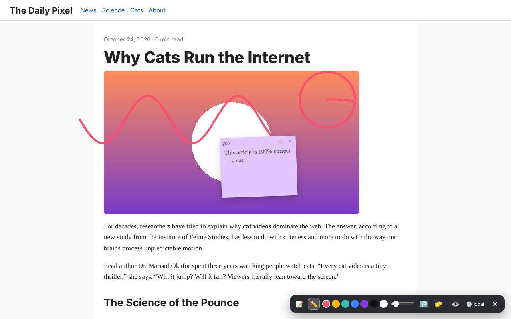

# Fun Chrome Extensions 🎉

Eight small, silly, fully working Chrome extensions (Manifest V3). No trackers, no analytics, no remote code.

八個不正經但真的能用的 Chrome 擴充功能。沒有追蹤、沒有分析、不載入遠端程式碼。

| | Extension | 中文 | What it does | Shortcut |
|---|---|---|---|---|
| ⌨️ | [Typing Rampage](typing-rampage) | 打字暴走模式 | Particles, screen shake and a combo meter in every text box | — |
| 🧱 | [Page Physics](page-physics) | 網頁物理模式 | The page collapses; drag, throw and stack everything. Esc restores | `Alt+Shift+G` |
| 🐣 | [Tab Pet](tab-pet) | 分頁寵物 | A toolbar blob that gets fatter the more tabs you open | — |
| 🖍️ | [Web Graffiti](web-graffiti) | 網頁塗鴉牆 | Sticky notes and doodles on any site; optional live multiplayer | `Alt+Shift+N` |
| 🏁 | [Wiki Race](wiki-race) | 維基百科競速 | Article A → article B using only links, timed, with challenge links | — |
| 🗡️ | [Page Dungeon](page-dungeon) | 網頁地城 | Any page becomes a roguelike: paragraphs are rooms, ads are monsters | `Alt+Shift+D` |
| 🎵 | [Page Symphony](page-symphony) | 網頁交響曲 | Every site has a theme song; record it to a file | `Alt+Shift+M` |
| ⏳ | [Web Time Machine](time-machine) | 網頁時光機 | 1995 desktop, 1998 homepage, green/amber CRT, plus snapshots | — |



## Install (developer mode) / 安裝

1. Download or clone this repo. 下載或 clone 這個 repo。
2. Open `chrome://extensions` and turn on **Developer mode**. 開啟 `chrome://extensions`，打開右上角「開發人員模式」。
3. Click **Load unpacked** and pick one of the extension folders (e.g. `tab-pet/`). 按「載入未封裝項目」，選擇任一個擴充功能資料夾。

Ready-to-upload zips for the Chrome Web Store are built with `./tools/build.sh` into `dist/`, and attached to each GitHub release.

## How each one works

### ⌨️ Typing Rampage
Hooks `keydown` in text inputs, textareas and contenteditable areas, finds the caret position with a mirror-div trick and bursts particles from it. Combo levels: NICE (10) → GREAT (25) → RAMPAGE! (50) → UNSTOPPABLE (100) → GODLIKE (200). Password fields are always ignored. Per-site off switch, four color themes, optional sound.

### 🧱 Page Physics
Clicking the icon clones every visible element into a [Matter.js](https://brm.io/matter-js/) world (bundled, MIT) and hides the originals with `visibility:hidden`, so the real page is never rearranged and **Esc** restores it exactly. Space = earthquake, arrows = gravity direction, `0` = zero-G, `B` or double-click = bomb. Uses only `activeTab` + `scripting`: it can't see any page until you click it.

### 🐣 Tab Pet
The pet's size and color follow your open tab count (hungry < 4, happy, full, stuffed, bloated, about to explode at 61+). The toolbar icon is redrawn live. **Snack mode** (off by default) lets it close your least-recently-used tab when you have too many; never pinned, audible or active tabs, and everything it eats can be "spat out" (reopened) from the popup. Also: one-click close duplicate tabs.

### 🖍️ Web Graffiti
Press `Alt+Shift+N` for a toolbar: sticky notes, freehand pen in 7 colors, undo, clear-mine, hide. Graffiti is saved per page in your browser and shows up when you come back.

**Multiplayer (optional):** run the relay in [`web-graffiti/server`](web-graffiti/server) and paste its `wss://` address in the options page. Everyone on the same server sees notes, strokes and cursors live.
- The server only ever receives a **SHA-256 hash** of the page URL, never the URL.
- Each install has a secret; your author ID is derived from it server-side, so nobody else can edit or delete your stuff.
- By default the extension only contacts the server when *you* open the toolbar on a page. "Look on every page" is opt-in.
- Mute anyone with 🔇. Size limits and rate limits are enforced server-side.

```bash
cd web-graffiti/server && npm install && npm start      # ws://localhost:8787
# or: docker build -t graffiti web-graffiti/server && docker run -p 8787:8787 -v graffiti:/data graffiti
```
Put it behind any TLS proxy (Caddy, Cloudflare Tunnel, Fly.io, Render…) to get a `wss://` URL.

### 🏁 Wiki Race
Pick start and target (or 🎲 random, or 📅 the daily challenge everyone shares), and race in en/zh/ja/de/fr/es Wikipedia. During a race the search box is hidden, only article links inside the article body count, redirects are handled, and a timer + click counter + path HUD sits on top. Finishing shows your path and a **Copy challenge** button: anyone with the extension who opens the link gets a "Start" banner for the same race.

### 🗡️ Page Dungeon
The page you're on is parsed into a seeded roguelike (same page → same dungeon): `h1/h2` sections are floors, paragraphs are written on room walls, images are treasure chests, **bold text** becomes potions, links are portals (Enter to actually follow them into a new dungeon) and ads / iframes become tough monsters. Other monsters are named after words on the page ("the Wild Internet", "Feline Slime"). Arrows/WASD/hjkl, bump to fight, Enter for stairs.

### 🎵 Page Symphony
Reads the DOM in order: headings are pad chords (and change the harmony), paragraphs become melodies (one note per word), list items arpeggiate, links ding, images ring like bells, code blocks chirp and buttons click, over a beat that gets busier as the page goes on. The key, mode and tempo come from the hostname, so every site has its own sound. The element being played is outlined and followed. ⏺ records the whole song to a `.webm` file. Pure Web Audio, no samples.

### ⏳ Web Time Machine
Four themes applied with injected CSS + a few decorations: **1995 Desktop** (teal desktop, bevelled window, taskbar clock), **1998 Homepage** (starfield, rainbow headings, marquee, visitor counter, sparkle cursor, under-construction sign), **Green / Amber Terminal** (phosphor glow, scanlines, tinted images, boot screen). 📸 saves a PNG of the visible tab. `Shift+Esc` or "Back to today" removes everything.

## Permissions at a glance

| Extension | Permissions | Why |
|---|---|---|
| Typing Rampage | `storage`, content script on all sites | Effects must run in text boxes everywhere; settings |
| Page Physics | `activeTab`, `scripting` | Only touches a page when you click the icon |
| Tab Pet | `tabs`, `storage`, `alarms` | Count tabs; show and restore eaten tab titles/URLs; snack timer |
| Web Graffiti | `storage`, `unlimitedStorage`, `activeTab`, `scripting`, content script on http(s) | Show saved graffiti when you revisit a page |
| Wiki Race | `storage`, content script on `*.wikipedia.org` | HUD and link rules on Wikipedia only |
| Page Dungeon | `activeTab`, `scripting` | Only on click |
| Page Symphony | `activeTab`, `scripting` | Only on click |
| Web Time Machine | `activeTab`, `scripting` | Only on click; snapshot uses the visible tab |

Privacy policy: [PRIVACY.md](PRIVACY.md).

## Tests

A headless test suite loads each extension's scripts against a fixture site (and a fake Wikipedia) with a stand-in `chrome.*` API, runs the real Tab Pet and Graffiti service workers in a sandbox, and runs the Graffiti relay server end-to-end with two simulated browsers. It also writes the store screenshots.

```bash
cd tests && npm install && node run.mjs            # set CHROME_PATH to use your own Chrome
python3 tools/store_assets.py tests/shots           # rebuild store/ images
```

## Project layout

```
<extension>/          one folder per extension, load-unpacked ready
web-graffiti/server/  optional multiplayer relay (Node + ws, Dockerfile)
store/                Web Store screenshots and promo tiles
STORE_LISTINGS.md     copy-paste text for every store listing (zh-TW + en)
tools/                icon generator, store asset builder, zip builder
tests/                headless tests
```

## License

MIT. Matter.js is © Liam Brummitt, MIT (see `page-physics/vendor/matter-js.LICENSE`).
